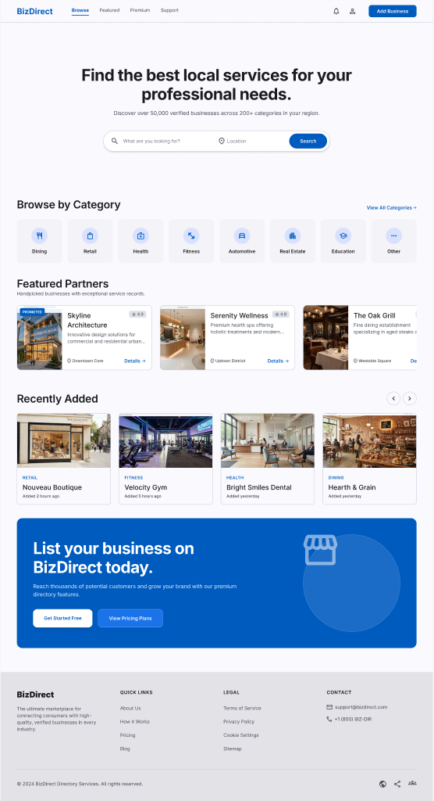

# Alfa Finda design in Figma

The original Alfa Finda design is the Figma file **ZimboBiz** (made when the product was called BizDirect):
https://www.figma.com/design/FxRp25rePeviDDzlnjsDuT/ZimboBiz

Figma limits how often Claude can read it on the Starter plan, so what matters is written down here. Read the file
again only for screens not covered below.

## What we took from it

- **Colour.** Alfa Finda's accent is Compass Blue `#005BBF`, the main blue in the design. It is the brand colour in
  the logo kit (github.com/global-alfabet/brand) and `--accent` in `src/styles/site.css`.
- **Home page layout** (Directory Home): search with a "what" field and a town field, Browse by category tiles,
  featured places, a row of listing cards, then a blue banner for business owners.
- **Look.** The site keeps the shared Global Alfabet look (pill buttons, 28px cards, `#f5f5f7` sections, Inter), as
  Julius decided. The Figma file's smaller corners and grey-violet backgrounds are not used.

## Colours in the design

| Used for | Hex | Site token |
| --- | --- | --- |
| Main blue: buttons, links, banner | `#005BBF` | `--accent`, `--accent-strong` |
| Brighter blue: second button | `#1A73E8` | `--accent-bright` |
| Pale blue: category icon circles | `#D8E2FF` | `--accent-soft` |
| Page background | `#FAF9FD` | not used (we use white and `--soft`) |
| Category tiles | `#F4F3F7` | not used (`--soft`) |
| Footer | `#E3E2E6` | not used |
| Borders | `#C1C6D6` | not used (`--line`) |
| Text / secondary text | `#1A1B1E` / `#414754` | not used (`--ink`, `--ink-2`) |

Type in the design: Inter. Headlines 48px bold, section headings 32px semibold, card titles 20px, body 14 to 16px,
category labels 12px uppercase.

## Not built yet

The design shows star ratings, "verified" counts, "Promoted" tags, pricing plans, messages, reviews and business
dashboards. These need real listings and the Global Alfabet Account. Until then the listing rules in CLAUDE.md apply:
no invented ratings, reviews or badges.

## Screens in the file

Desktop: Content and taxonomy management `401:3`, Super admin dashboard `401:669`, Business directory management
`401:1046`, Business profile `401:1386`, Directory home `401:1651`, Admin dashboard `401:1954`, Search results
`401:2206`.

Mobile: Super admin dashboard `401:321`, Business approvals `401:498`, Edit profile `401:5079`, Photo gallery
`401:5367`, Manage reviews `401:5554`, Admin dashboard `401:5854`, Business profile `401:6076`, Settings `401:6359`,
Search results `401:6542`, Directory home `401:6767`, Register business `401:7014`, Login `401:7099`, Messages
`401:7160`.

Only Directory home (desktop) has been read so far.
